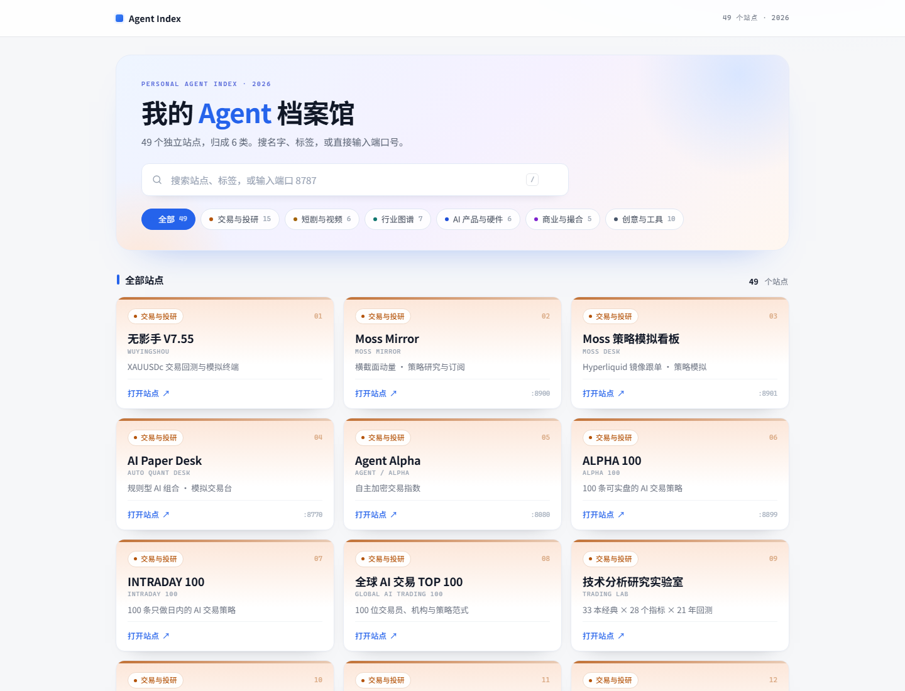

<div align="center">

# 我的 Agent 档案馆

**49 个 AI / Agent / 交易 / 视频 / 硬件项目的个人索引**

搜索、筛选、直达——把散落的项目收进一个页面。

[🌐 在线浏览](https://time31119.github.io/agent-index/) · [📂 目录页](https://time31119.github.io/agent-index/agent-hub/) · [⭐ Star](https://github.com/time31119/agent-index)



</div>

---

## 这是什么

一个纯静态的个人项目索引站：把 49 个独立站点按 6 类整理，支持按名字、标签、端口搜索，点开即用。

- **交易与投研** 15 个：AI Paper Desk、Moss Mirror、无影手、ALPHA 100、INTRADAY 100……
- **短剧与视频** 6 个
- **行业图谱** 7 个
- **AI 产品与硬件** 6 个：NEXUS EDGE、Lumen、Botique……
- **商业与撮合** 5 个
- **创意与工具** 10 个：星语测试、NexusGate、APEX……

## 怎么用

1. 打开 **[目录页](https://time31119.github.io/agent-index/agent-hub/)**
2. 输入名字、标签，或直接输入端口号（如 `8770`、`8900`）
3. 点卡片查看详情，再点「打开站点」

> 部分条目是**本地服务**（卡片上标有端口，如 `:8770`），需要在本机启动对应程序才能访问；
> 其余静态页面可以直接在线打开。

## 目录结构

```text
agent-index/
├── index.html            # 跳转到 agent-hub/
├── agent-hub/            # 目录页（搜索 / 筛选 / 详情）
├── paper-desk/           # 静态快照示例
├── wuyingshou/           # 无影手
├── luna-quiz/            # 星语测试
├── nexus-edge-site/      # 枢元智联
└── ...                   # 其余静态子站
```

## 维护

- 条目数据在 `agent-hub/app.js` 的 `AGENTS` 数组里，改完刷新即可
- `agent-hub/agents.json` 是同一份数据的 JSON 导出
- 新增静态子站时，把文件夹放在仓库根目录，并在 `AGENTS` 里写相对路径 `../<folder>/index.html`

## 说明

- 站点用 GitHub Pages 托管，纯静态、无后端、无追踪脚本
- 本地服务的地址只在你自己的机器上有效，公网访客请以静态页面为准
- 截图与项目内容归各自作者所有

如果这个索引对你有用，欢迎点个 ⭐ 或提 Issue 推荐新站点。
