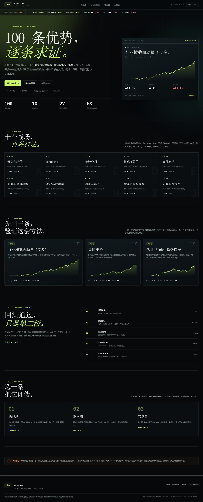

# ALPHA 100 · 100 条可实盘的 AI 交易策略

一个独立的静态研究站：**100 条策略档案 + 历史回测实验室 + 交易复盘台**。

不是信号服务，也不是“100 个赚钱保证”。它把每条想法写到可以下单的程度——入场、出场、仓位、数据、执行场所、失败模式、证据等级——然后让你用固定数据、固定成本和样本外切分去证伪它。



## 打开

### 本地服务器（推荐）

在 `alpha100` 目录下：

```bash
python -m http.server 8899 --bind 127.0.0.1
```

然后打开 <http://127.0.0.1:8899/>。

Windows 也可以双击 `start-server.bat`。

> 直接双击 `index.html` 也能看，但部分浏览器会限制 `file://` 下的 `localStorage`，导致复盘记录无法保存。建议用本地服务器。

### 部署

整个目录都是静态文件，没有后端、没有构建步骤、没有外部 CDN。直接上传到任意静态托管：

- GitHub Pages
- Netlify / Vercel（Build command 留空，Publish directory 指向本目录）
- Nginx / Apache / 对象存储

所有路径都是相对路径，放在子目录也能用。

## 里面有什么

- **100 条策略**，按 10 个家族组织，每个家族 10 条：
  趋势动量、均值回归、统计套利、横截面因子、事件驱动、新闻与语言模型、期权与波动率、加密与链上、微观结构与执行、宏观与跨资产。
- **27 条可直接回测**：嵌入 38 个标的的调整后日线（2017–2026），支持改日期、改成本、改参数，实时重跑。
- **35 条纸面验证**：给出 4 步验证协议，不假装能用日线回测。
- **35 条需另类数据**：期权链、链上、财报、研报、盘口等；明确写出数据门槛。
- **3 条结构核验**：MEV、做市、延迟套利等基础设施型策略，重点是工程与执行。
- **证据阶梯 E0–E4**：每条策略标注当前证据等级，不把“回测跑通”包装成“可以实盘”。
- **复盘台**：记录交易、收益、R 倍数、执行质量、错误标签；自动算胜率、盈亏比、最大回撤、平均 R；支持 JSON 导出/导入。
- **实盘检查清单**：每条策略的检查项可勾选，状态保存在本机。
- **命令面板**：`⌘K` / `Ctrl+K` 搜索 100 条策略。

## 回测口径

- 数据：Yahoo Finance chart API，按拆分/分红调整的日线 OHLCV；生成后嵌入 `assets/js/market-data.js`，运行时不联网。
- 信号：收盘后计算；默认次日开盘执行，避免“同一根 K 线收盘价成交”的前视偏差。
- 成本：单边 2–5 bps（按策略），不含融资、借券、税、冲击成本。
- 切分：按时间 70% 样本内 / 30% 样本外，页面同时展示全样本、样本内、样本外指标。
- 结论标签：
  - `样本外通过`：全样本与样本外都为正，且样本外交易数 ≥5。
  - `仅样本外通过`：全样本不够好，但样本外为正。
  - `样本外未通过`：样本外为负或没有优势。
  - `样本不足`：交易数太少，统计上不能下结论。

> 回测只能证明“规则在这段历史上能跑”，不能证明未来会赚钱。尤其是 005、019、031、076 存在幸存者偏差，页面已用橙色警告标出；035 只验证了价格动量骨架，资金流数据未嵌入。

## 文件结构

```text
alpha100/
├─ index.html
├─ assets/
│  ├─ css/style.css
│  └─ js/
│     ├─ market-data.js      # 38 个标的的调整后日线（生成文件）
│     ├─ strategies.js       # 100 条策略档案（生成文件）
│     ├─ results.js          # 27 条预计算回测结果（生成文件）
│     ├─ engine.js           # 指标、信号、回测、绩效
│     └─ app.js              # 路由、视图、图表、复盘、命令面板
├─ data/
│  ├─ strategies.json        # 100 条策略的 JSON
│  └─ strategy-index.csv     # 100 条策略索引（可下载）
├─ scripts/
│  ├─ fetch_market_data.py   # 拉取并清洗 Yahoo 日线
│  ├─ build_strategies.py    # 校验并生成 strategies.js / JSON / CSV
│  ├─ build_results.mjs      # 跑 27 条回测并生成 results.js
│  ├─ qa.mjs                 # 无头浏览器交互测试
│  └─ data/                  # 10 个家族 × 10 条策略的 Python 数据
├─ preview-*.png
├─ start-server.bat
└─ README.md
```

## 重新生成

需要 Python 3 和 Node.js。

```bash
# 1. 拉取行情（可选；仓库已带生成好的 market-data.js）
python scripts/fetch_market_data.py

# 2. 校验 100 条策略并生成前端数据
python scripts/build_strategies.py

# 3. 跑 27 条回测，生成 results.js
node scripts/build_results.mjs
```

`build_strategies.py` 会校验：

- 恰好 100 条，编号 001–100；
- 10 个家族各 10 条；
- id / slug 唯一；
- 每条都有完整规则、AI 用法、风控、数据、执行、失败模式；
- 回测型策略的 engine / params 合法。

## 数据存在哪

- 复盘交易与周复盘：`localStorage` key `alpha100.journal.v1`
- 实盘检查清单：`alpha100.checks.v1`
- 本机回测运行记录：`alpha100.runs.v1`

换电脑/换浏览器：复盘台 → 导出 JSON → 在新浏览器导入。

## 边界与免责声明

本站是研究与教育工具，不构成投资建议。所有策略、回测、指标与示例都可能包含错误。交易涉及亏损风险；杠杆、期权、期货、加密资产与做空可能造成超过本金的损失。实盘前请完成样本外验证、纸面跟踪、独立风控与合规审查。

一句话：**先证伪，再实盘；先小钱，再放大；先活着，再谈收益。**
