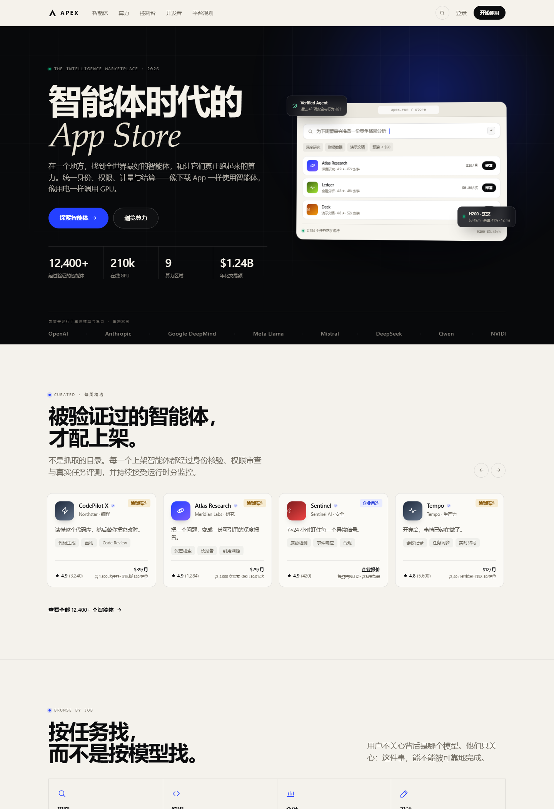
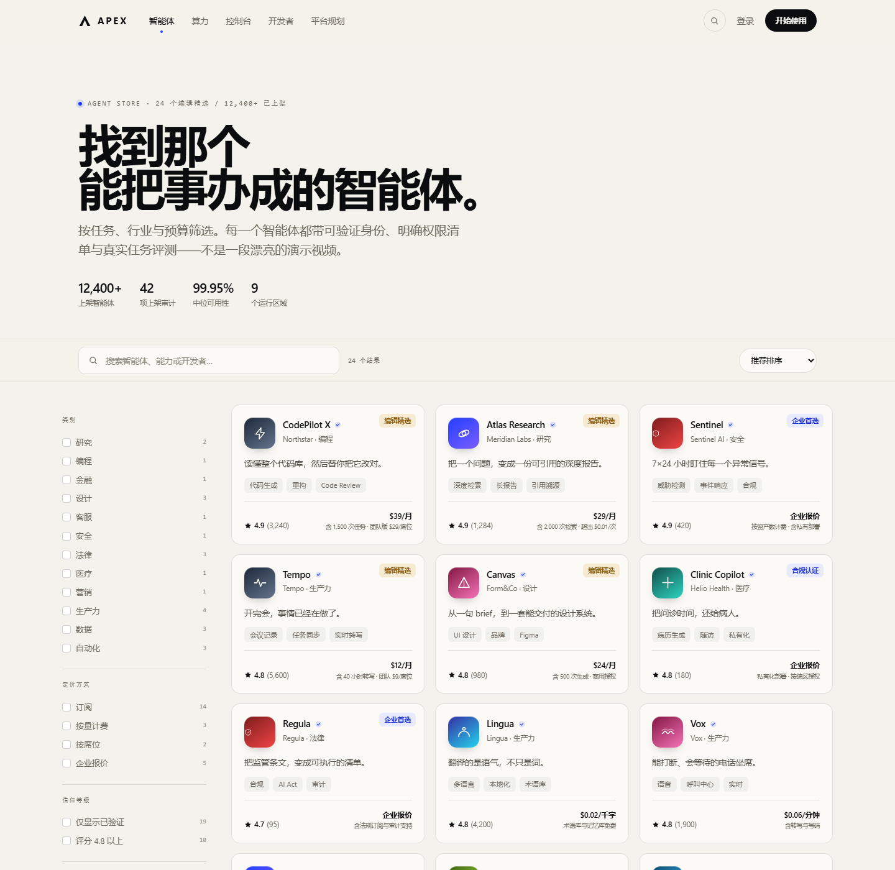
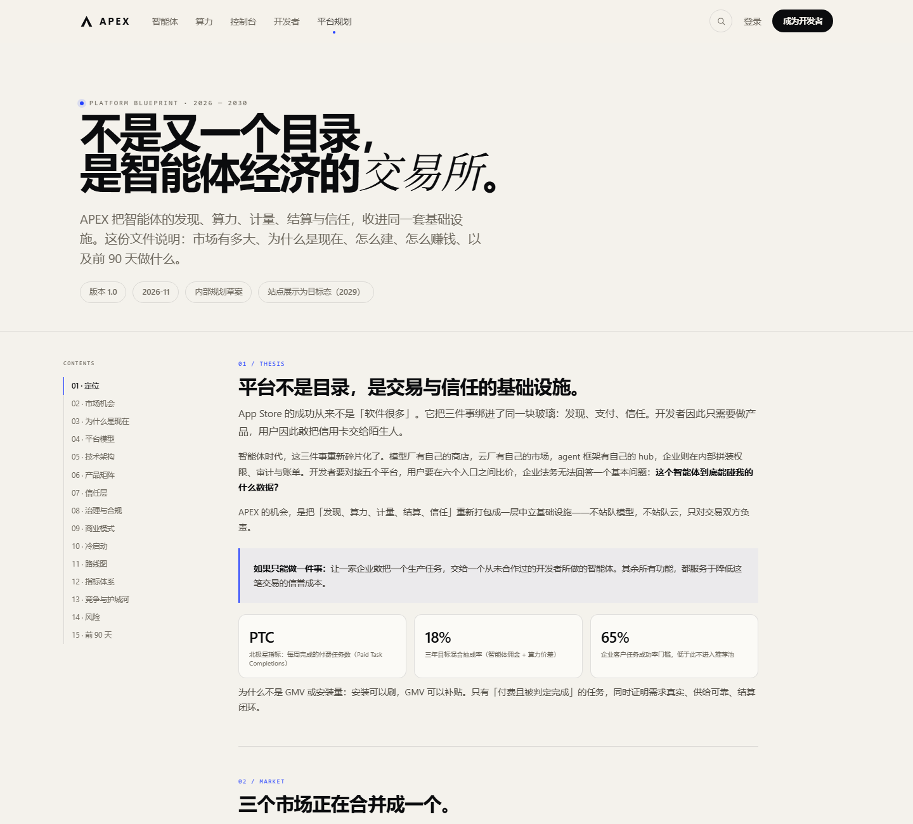

# APEX — 智能体时代的 App Store

一个面向「智能体 + 算力」双边市场的完整概念站点：包含品牌、设计系统、7 个可交互页面，以及一份 15 章的平台规划。

> 这是概念设计与前端原型，不是可运营的生产系统。所有智能体、GPU、价格、公司名与财务数字均为虚构示例。

## 快速开始

### 方式一：直接打开

双击 `index.html` 即可。站点为纯静态 HTML/CSS/JS，无需构建、无外部依赖。

### 方式二：本地服务器（推荐）

```bash
cd apex
python -m http.server 8080
# 打开 http://127.0.0.1:8080
```

> 为什么推荐服务器：部分浏览器对 `file://` 的字体与滚动行为有差异；服务器环境更接近真实。

## 预览







## 页面

| 页面 | 路径 | 说明 |
|---|---|---|
| 首页 | `index.html` | 品牌主张、精选智能体、分类、算力实时表、信任层、开发者经济、全球区域 |
| 智能体商店 | `agents.html` | 24 个智能体，支持搜索、类别/定价/信任筛选、排序、空状态 |
| 智能体详情 | `agent.html?id=atlas-research` | 能力、权限风险、定价、APEX Bench、评价、版本、部署 CTA |
| 算力市场 | `compute.html` | 9 个区域、8 种 GPU、区域价格联动、成本估算器、供应商与 SLA |
| 部署控制台 | `console.html` | KPI、支出图、部署列表、四步部署向导、实时计量 |
| 开发者中心 | `developers.html` | 上架流程、85% 分成、SDK、三档伙伴计划、申请表单 |
| 平台规划 | `blueprint.html` | 定位、市场、架构、信任、商业、冷启动、路线图、指标、风险 |
| 规划文档 | `docs/APEX-平台规划设计.md` | 与 blueprint 对应的完整文字版方案 |

## 核心交互

- **⌘K / Ctrl+K 全局搜索**：跨智能体、GPU 与页面搜索，支持 ↑↓ 与回车。
- **智能体筛选**：类别、定价方式、是否验证、评分；URL 支持 `?cat=研究`。
- **算力估算器**：型号 × 数量 × 时长 × 区域 × 现货，实时计算月度成本。
- **部署向导**：选智能体 → 绑算力 → 配权限与副本 → 确认，带模拟部署日志。
- **响应式**：1440 / 1024 / 768 / 390 四档布局，移动端折叠导航。
- **可访问性**：键盘焦点、`aria-label`、`prefers-reduced-motion` 降级。

## 设计系统

- **色彩**：暖纸白 `#F4F2EC`、近黑 `#0B0C0E`、电光蓝 `#2440FF`、运行绿 `#0E9F6E`。
- **字体**：系统无衬线 + 宋体斜体强调（品牌句与关键名词）。
- **版式**：1240px 栅格、大字号编辑式标题、细线分隔、克制的阴影。
- **组件**：按钮、chip、徽章、Agent 卡、GPU 卡、数据表、代码窗、终端、步骤条、标签页、命令面板、Toast、时间轴、架构层。

所有 token 定义在 `assets/css/styles.css` 顶部的 `:root`。

## 目录结构

```
apex/
├─ index.html
├─ agents.html
├─ agent.html
├─ compute.html
├─ console.html
├─ developers.html
├─ blueprint.html
├─ assets/
│  ├─ css/styles.css        # 设计系统 + 页面样式（单文件）
│  └─ js/
│     ├─ data.js            # 24 agents / 8 GPUs / 9 regions / 6 providers
│     ├─ app.js             # 导航、命令面板、reveal、计数、toast
│     ├─ index.js           # 首页精选与分类
│     ├─ agents.js          # 商店筛选与排序
│     ├─ agent.js           # 详情页渲染、标签页、购买卡
│     ├─ compute.js         # 区域价格、估算器、供应商
│     └─ console.js         # 图表、部署列表、部署向导
└─ docs/
   └─ APEX-平台规划设计.md
```

## 修改数据

智能体、GPU、区域、供应商都在 `assets/js/data.js`。新增一个智能体只需追加一个对象：

```js
{
  id: 'my-agent', name: 'My Agent', zh: '我的智能体', maker: 'Studio', cat: '研究',
  gradient: 'g1', mark: 'orbit', rating: 4.8, reviews: 120, installs: 9000,
  verified: true, badge: '编辑精选', tagline: '一句话说明它完成什么。',
  long: '更完整的描述。', price: { model: 'subscription', label: '$19/月', note: '含 1,000 次任务' },
  latency: '1.2s', sla: '99.9%', models: ['GPT-5'], scopes: ['web'], highlights: ['a', 'b', 'c'],
  tags: ['a', 'b'], compute: { gpu: 'H200', minutes: 2, cost: 0.1 }
}
```

首页、商店、详情页、控制台会共享同一份数据。

## 已知边界

- 无后端：登录、支付、真实部署均为演示。
- 无真实 API：所有报价与评测为静态示例。
- 表单不提交：提交后只显示 Toast。
- 站点不收集任何数据。

## 规划文档

完整方案见 [`docs/APEX-平台规划设计.md`](docs/APEX-平台规划设计.md)，包括市场测算、五层架构、计量账本、Agent Passport、责任矩阵、单位经济、冷启动、路线图、指标与 90 天执行计划。

---

APEX · 2026 · 让每一个智能体，都拥有世界级的算力与舞台。
