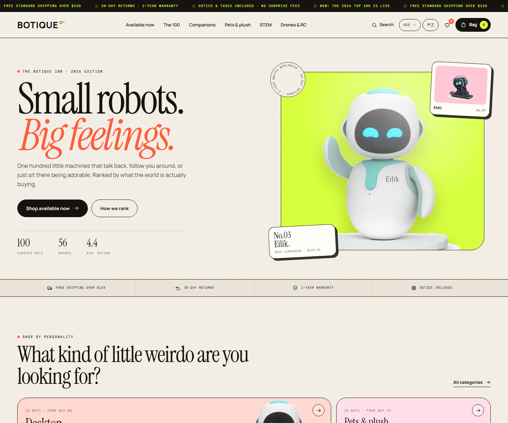
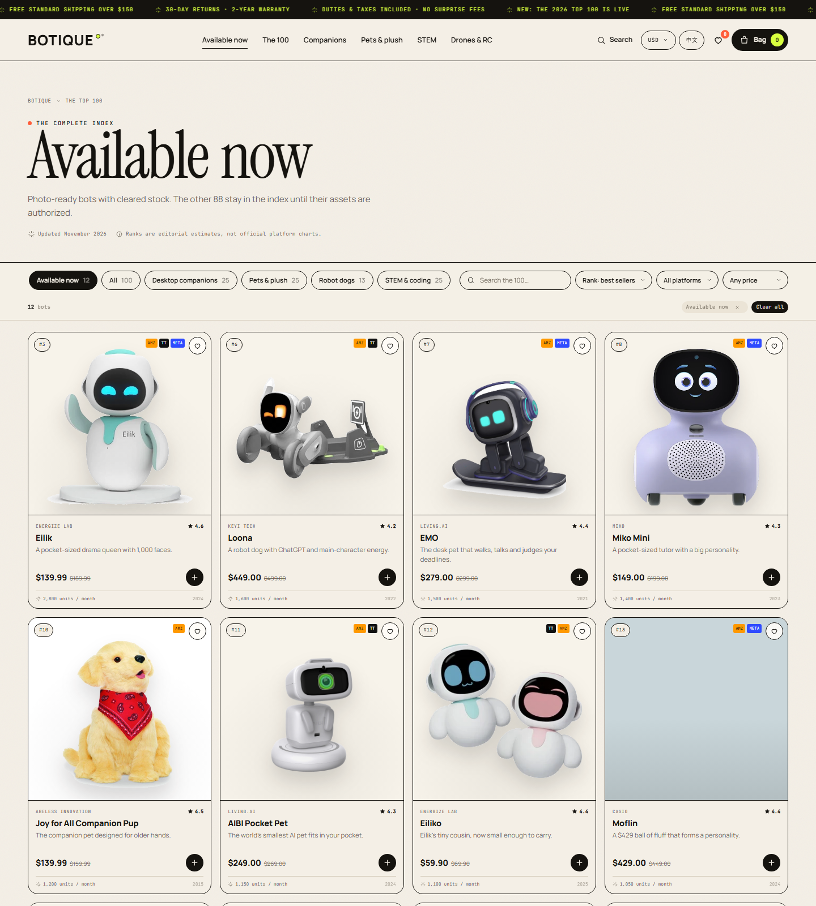

# BOTIQUE — 全球小型机器人独立站

> Small robots. Big feelings.
>
> 一个可浏览、可筛选、可加购、可结账的全球电商前台，商品池为 2026 年 Amazon / TikTok Shop / Meta Shops 热销小型机器人 TOP 100。





---

## 1. 现在的状态

- **100 款商品**、56 个品牌、5 个分类。
- **首批可售 12 款**：有真实商品图、进入 checkout 的 SKU。
- **其余 88 款为 Index only**：保留榜单、详情、收藏，但**不显示加购/结账**，只提供到货通知。
- 完整购物链路只对 12 款可售 SKU 开放：加购、收藏、结账、折扣码、订单成功页。
- 9 种货币、中英双语、全球配送、DDP 含税展示。
- 纯静态、零构建，可部署到 Cloudflare Pages / Netlify / Vercel。

### 首批可售 12 款

Eilik、Eiliko、Loona、EMO、AIBI、Moflin、Joy for All Pup、Miko 3、Miko Mini、Sphero BOLT、Sphero Mini、DJI Neo。

> 可售状态来自 `p.launch`。在 `data.js` 的 `IMAGES` 里删除/增加条目，会自动改变可售集合。
> 全量 100 款仍可在 `shop.html` 浏览；首批可售集合在 `shop.html?launch=1`。

### ⚠️ 真实商品图的版权前提

Amazon、品牌官网、零售商的商品图**不是默认可商用素材**。当前 12 张图标记为 `official-demo`，用于搭建与评审；**正式收款前必须替换为品牌授权素材，或你们自己拍摄的图**。

剩余 88 款的补图规格、命名和授权状态见 [IMAGE_GUIDE.md](IMAGE_GUIDE.md)，覆盖清单见 [data/image-status.csv](data/image-status.csv)。

---

## 2. 快速预览

直接双击 `index.html` 即可。更推荐本地静态服务器：

```bash
cd botique
python -m http.server 5500
```

打开 <http://localhost:5500>。

### 预览参数

| URL | 作用 |
| --- | --- |
| `index.html?preview=cart` | 预置 2 件商品并打开购物袋 |
| `index.html?gift=1` | 打开礼物助手 |
| `index.html?search=1` | 打开搜索层 |
| `shop.html?launch=1` | 只看 12 款可售 SKU |
| `checkout.html?preview=1` | 预置 3 款可售商品，查看完整结账页 |

---

## 3. 页面与功能

- **首页**：品牌 Hero、分类、TOP 10、完整榜单入口、编辑推荐、礼物助手、内容导购、订阅。
- **商店页**：100 款榜单 + “Available now” 12 款可售筛选；分类/平台/价格/关键词、5 种排序。
- **商品详情**：可售款展示加购/配送；Index only 款展示“到货通知 + 邮箱”，不进入结账。
- **购物袋 / 收藏**：localStorage 持久化；只接受可售 SKU，旧购物袋里的 Index only 会自动清理。
- **结账**：只对 12 款可售 SKU 开放；全球地址、标准/加急配送、折扣码 `WELCOME10`、Demo 支付、成功页。
- **榜单页**：平台覆盖、分类构成、100 行可排序数据表、CSV 下载、方法说明与来源。
- **内容与政策**：2026 选购指南、配送/退货/2 年保修/隐私/条款/Cookie/无障碍/订单查询。

---

## 4. 目录结构

```text
botique/
├── index.html                 首页
├── shop.html                  全部 100 款
├── product.html              商品详情（?id=eilik）
├── checkout.html             结账
├── ranking.html              排名方法 + 数据表 + CSV
├── guide.html                2026 选购指南
├── policies.html             政策中心（?p=shipping 等）
├── assets/
│   ├── css/style.css         设计系统与全部页面样式
│   ├── js/data.js            100 款商品 + 真实图 manifest
│   ├── js/robot.js           真图优先 / SVG 插画 fallback
│   ├── js/app.js             页头/页脚、购物袋、收藏、搜索、货币、i18n
│   ├── js/home.js            首页 + 礼物助手
│   ├── js/shop.js            筛选/排序/分页
│   ├── js/product.js         商品详情
│   ├── js/checkout.js        结账流程
│   ├── js/ranking.js         图表、表格、CSV
│   ├── js/guide.js           指南页推荐位
│   ├── js/policies.js        政策内容
│   ├── js/config.js          支付/分析/物流配置
│   ├── products/             真实商品图（12/100）
│   └── favicon.svg
├── data/top100.csv           榜单数据表
├── data/image-status.csv     100 款商品图覆盖状态与来源
├── IMAGE_GUIDE.md            商品图规格、命名、授权与替换流程
├── SELLING.md                开卖前的合规、支付、履约清单
└── README.md
```

改商品只需改 `assets/js/data.js`。每行字段：

```js
[rank, id, name, brand, category, form, price, compareAt, rating, reviews, units, platforms, tagline, note, year, tone, badge]
```

- `category`: `companion` / `pets` / `dogs` / `stem` / `rc`
- `platforms`: `amazon,tiktok,meta` 任意组合

---

## 5. 真实图与插画的切换逻辑

`data.js` 底部有一个 `IMAGES` manifest：

```js
eilik: {
  files: ['assets/products/eilik/01.webp', 'assets/products/eilik/02.webp'],
  alt: 'Eilik desktop companion robot waving',
  source: 'https://energizelab.com/consumerview/eilik',
  credit: 'Energize Lab',
  rights: 'official-demo'
}
```

- 有条目：卡片、详情、购物袋、结账摘要、搜索、OG 全部用真实图。
- 没有条目：自动用 `robot.js` 的 SVG 插画。
- `layout: 'lifestyle'`：适合手持/场景横图，卡片和详情主图使用 `object-fit: cover`。
- 多张图：详情页缩略图按 `files` 顺序展示。

当前 12 款：Eilik、Eiliko、Loona、EMO、AIBI、Moflin、Joy for All Pup、Miko 3、Miko Mini、Sphero BOLT、Sphero Mini、DJI Neo。

> 插画不是“占位图”那么简单：100 款有 100 个唯一造型组合（眼睛、嘴型、配饰、贴纸、花纹、比例、镜像）。`lookFor()` 可审计。

---

## 6. 接入真实支付

打开 `assets/js/config.js`：

```js
payments: {
  mode: 'demo',              // 改成 'stripe-links'
  paymentLinks: {
    eilik: 'https://buy.stripe.com/...'
  }
}
```

- **Stripe Payment Links**：最快上线，单商品购物车直接跳转。
- **Stripe Checkout + Serverless**：推荐，服务端按数据库价重新计价，Webhook 发货。
- **PayPal / Shopify Buy Button / Lemon Squeezy**：也可作为托管结账。

纯静态站不能安全创建 Checkout Session；`checkout.js` 的 `placeOrder()` 已拆分，接真实支付时替换该函数即可。详见 [SELLING.md](SELLING.md)。

---

## 7. 部署

### Cloudflare Pages

```text
Build command: （留空）
Build output directory: /
```

### Netlify

```text
Build command: （留空）
Publish directory: .
```

### Vercel

```text
Framework preset: Other
Build command: （留空）
Output directory: .
```

上线后替换各页 `canonical` / `og:url` 为真实域名。

---

## 8. 上线前必须替换

| 位置 | 当前值 | 说明 |
| --- | --- | --- |
| `config.js` | `mode: 'demo'` | 接真实支付 |
| 客服邮箱 | `hello@botique.shop` | 换成真实邮箱 |
| 政策地址 | 新加坡概念地址 | 换成真实注册地址 |
| 域名 | `https://botique.shop` | 换成真实域名 |
| 商品图 | 12/100 `official-demo` | 换成授权图/自拍图 |
| 社媒链接 | `#` | 换成真实账号 |
| 排名数据 | 2026-11-01 快照 | 每月更新 |

---

## 9. 数据说明

Amazon、Meta、TikTok 都不公开发布品类级官方销量榜。站内排名是 **BOTIQUE Demand Index**：基于公开畅销页、评价增速、上架时间、库存状态和第三方销量估算，页面和 CSV 标了 `Est.`。

参考来源：

- [AMZ123：TikTok AI 机器狗案例](https://www.amz123.com/t/HUGuwESO)
- [雨果跨境：2026 AI 玩具报告](https://www.upkuajing.com/knowledge/zixun/25701)
- [Amazon pet robot top 10 public-data snapshot](https://www.videostrong.com/news-show/amazon-us-pet-robot-top10-2026)
- [Companion robot market research](https://longlivethemech.github.io/robot-market-research/)
- [CES 2026：25 款 AI 陪伴机器人](https://www.ednchina.com/technews/38304.html)

---

## 10. 验证

- 100 条商品、排名 1–100 唯一、ID 唯一。
- 100/100 唯一插画 look。
- 桌面 1440 / 平板 1024 / 手机 390。
- 加购、收藏、搜索、筛选、结账、折扣码、货币、语言均通过浏览器 QA。
- JS 控制台错误：0。

---

## 11. 许可与声明

- 代码与 SVG 插画：本项目原创实现，可修改用于你的商店。
- 产品名称、品牌、商标：归各自所有者。BOTIQUE 是独立策展方，与品牌无隶属关系。
- 真实商品图：当前为 `official-demo`，商用前需取得授权；来源见 `data/image-status.csv`。
- 价格、评分、评价数、销量：公开信息快照 + 估算，不构成购买建议。
