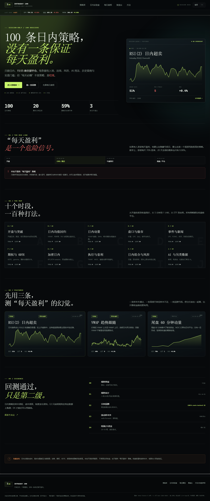

# INTRADAY 100 · 100 条只做日内的 AI 交易策略

一个独立静态网站：**100 条日内策略档案 + 真实分钟数据回测 + 每日盈亏/连亏统计 + 日内复盘台**。

> 先说结论：**没有任何策略能保证每天盈利。** 任何声称“每天必赚”的日内策略，通常在三件事上作弊：隐藏亏损日、承担极端尾部风险、或事后挑选。本站不卖这个承诺；它把“每天盈利”拆成绿天率、最大连亏、最差单日与样本外表现，让你自己算清楚。



## 打开

在 `intraday100` 目录下：

```bash
python -m http.server 8900 --bind 127.0.0.1
```

打开 <http://127.0.0.1:8900/>。

Windows 也可以双击 `start-server.bat`。

## 里面有什么

- **100 条策略，10 个家族**：开盘/突破、均值回归、日内动量、盘口与做市、事件/新闻、期权/0DTE、加密、执行/套利、组合/风控、AI 与另类数据。
- **全部只做日内**：每条都有 session 时段与强平规则；不持有隔夜。
- **20 条真实分钟数据回测**：5 分钟（60 天）、1 小时（2 年）、加密 1 小时（1 年）；可改数据集、日期、成本、参数，实时重跑。
- **45 条纸面验证、30 条需另类数据、5 条结构核验**：没有硬凑假回测，分别给出验证协议。
- **每日真相页**：交互式模拟器，计算“20 天全绿”“至少 1 个亏损日”“最大连亏中位”等概率；并列出所有回测策略的绿天率、最大连亏、最差单日。
- **日内复盘台**：记录入场/出场时间、当日盈亏、R 倍数、错误标签；自动算绿天率、最大连亏、最差单日；检测隔夜违规；JSON 导出/导入。
- **历史案例**：20 条回测显示真实的最佳/最差交易；其余给出事件场景，并明确标注“不是已验证的盈利记录”。
- **证据阶梯 E0–E4**：回测通过不等于可以实盘；实盘前还有纸面/小资金门槛。

## 回测口径

- **5m**：2026-08-11 → 2026-11-03，SPY/QQQ/IWM/AAPL/NVDA/TSLA，4,681 根 bars。
- **1h**：2023-12-06 → 2026-11-03，SPY/QQQ/IWM/AAPL/NVDA/TSLA/MSFT/GLD/TLT/USO，5,084 根 bars。
- **crypto 1h**：2025-11-05 → 2026-11-04，BTC/ETH，8,729 根 bars。
- 成本：单边 1.5–4 bps（按策略），不含融资、借券、税、冲击。
- 切分：按时间 70% 样本内 / 30% 样本外。
- 结论标签：
  - `样本外通过`：全样本与样本外都为正，交易数与绿天率达标。
  - `仅样本外通过`：全样本不够好，但样本外为正。
  - `样本外未通过`：样本外为负或没有优势。
  - `样本不足`：交易数太少，统计上不能下结论。
- 当前 **3/20** 条样本外通过。大多数日内策略在扣成本后没有稳定优势——这正是本站要展示的。

## 为什么“每天盈利”不可信

假设每天独立、胜率 70%。20 天全绿的概率是：

```text
0.7^20 ≈ 0.0008 = 0.08%
```

至少出现一个亏损日的概率是 **99.92%**。如果胜率 62%，20 天全绿约 **0.01%**。

这不是策略好坏，而是算术。亏损日会连在一起；即使正期望，连亏 3–5 天也很常见。任何“每天盈利”的展示，通常来自隐藏亏损日、极端尾部风险或事后挑选。

## 文件结构

```text
intraday100/
├─ index.html
├─ assets/
│  ├─ css/
│  │  ├─ style.css          # 共享视觉系统
│  │  └─ intraday.css       # 日内/每日真相/日 K 样式
│  └─ js/
│     ├─ intraday-data.js   # 5m/1h/crypto bars（生成文件，约 4 MB）
│     ├─ strategies.js      # 100 条策略（生成文件）
│     ├─ results.js         # 20 条回测结果（生成文件）
│     ├─ engine.js          # 日内 bar 引擎
│     └─ app.js             # 路由、视图、图表、模拟器、复盘
├─ data/
│  ├─ strategies.json
│  └─ intraday-index.csv
├─ scripts/
│  ├─ fetch_intraday.py
│  ├─ build_strategies.py
│  ├─ build_results.mjs
│  ├─ qa.mjs
│  ├─ verify_site.mjs
│  └─ data/                 # 10 个家族 × 10 条策略
├─ preview-home.png
├─ preview-lab.png
├─ preview-detail.png
├─ preview-daily.png
├─ start-server.bat
└─ README.md
```

## 重新生成

需要 Python 3 和 Node.js。

```bash
python scripts/fetch_intraday.py
python scripts/build_strategies.py
node scripts/build_results.mjs
node scripts/verify_site.mjs
```

## 部署

整个目录是纯静态文件，没有后端、没有 CDN 依赖。上传到任意静态托管：

- GitHub Pages
- Netlify / Vercel（Build command 留空，Publish directory 指向本目录）
- Nginx / Apache / 对象存储

## 数据存在哪

- 复盘交易与周复盘：`localStorage` key `intraday100.journal.v1`
- 检查清单：`intraday100.checks.v1`
- 本机回测运行记录：`intraday100.runs.v1`

复盘台支持导出/导入 JSON。

## 边界与免责声明

本站是研究与教育工具，不构成投资建议。日内交易成本高、杠杆风险大；期权、0DTE、加密、微观结构策略可能造成超过本金的损失。历史回测不代表未来收益。

**没有“每天盈利”策略。** 如果有人说有，先问他亏损日去哪了。

一句话：**先证伪，再实盘；先小钱，再放大；先活着，再谈收益。**
