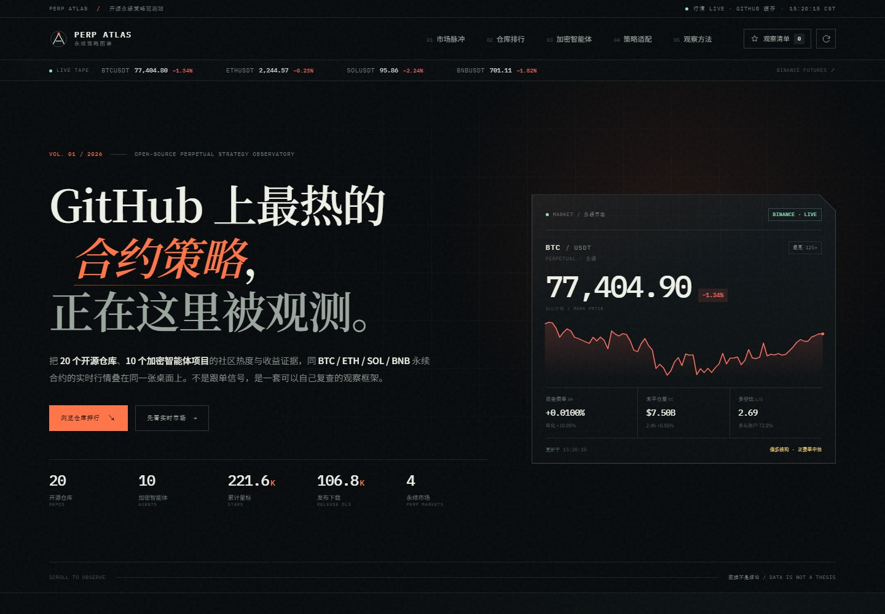

# PERP ATLAS · 开源合约策略观测站

把 GitHub 上最受关注的永续合约策略仓库、Release 下载量与真实永续行情放进同一张观察桌面。




**这不是策略超市，也不是收益排行榜。** 没有跟单入口、没有「必胜参数」，不接交易账户、不发送订单。它做的事情只有四件：

1. 把 20 个开源合约策略 / 执行框架整理成可筛选的索引；
2. 只收 10 个加密原生 AI 交易智能体，按公开证据质量分级，拒绝无审计收益背书；
3. 用公开 API 展示当前永续市场的价格、资金费率、持仓与多空结构；
4. 把行情翻译成一组可解释的策略环境分，帮助判断「现在更适合读哪一类策略」。

---

## 本地运行

推荐用本地静态服务器打开，避免浏览器对 `file://` 的跨域限制。

```bash
cd perp-atlas
python -m http.server 8000
```

然后打开 <http://127.0.0.1:8000>。

Windows 也可以直接双击 `serve.cmd`。

不需要安装 Node、不需要构建、不需要 API Key。

---

## 页面结构

| 区块 | 内容 |
| --- | --- |
| Hero / 实时终端 | 当前所选永续的标记价格、24h 涨跌、资金费率、OI、多空比与微型走势 |
| 01 市场脉冲 | BTC / ETH / SOL / BNB 切换、1m / 5m / 15m / 1h K 线、EMA20/60、成交量、24h 区间、费率倒计时 |
| 02 仓库排行 | 20 个仓库，按星标 / Release 下载 / 最近更新 / 综合分排序；方向筛选、搜索、观察清单、仓库详情 |
| 03 加密智能体 | 10 个加密原生 AI 交易智能体，按公开证据 A/B/C 分级；支持证据优先 / 热度 / 更新排序 |
| 04 策略适配 | 基于当前 K 线的趋势、网格、费率套利、做市、突破五类 0–100 环境分与雷达图 |
| 05 观察方法 | 数据口径、刷新频率、能证明 / 不能证明什么、边界声明 |

### 交互

- 点击合约切换全页行情与策略环境分
- 点击 K 线周期切换图表
- 点击仓库行查看策略结构、风险注记、最近提交
- 星标按钮把仓库加入浏览器本地观察清单
- 点击策略族直接筛出对应仓库
- 智能体榜切换「证据优先 / 热度 / 更新」
- 45 秒自动轮询行情；GitHub 数据 30 分钟尝试同步一次
- 刷新按钮手动同步行情与 GitHub
- 下载排序会按需汇总 GitHub Release 资产下载量

---

## 数据口径

### GitHub 仓库

- 仓库宇宙：人工整理的 20 个合约策略 / 执行框架，元数据在 `data.js`。
- 实时字段：`stargazers_count`、`forks_count`、`open_issues_count`、`pushed_at`、`language`、`license`。
- 接口：`https://api.github.com/repos/{owner}/{repo}`，匿名限额 60 次/小时。
- 缓存：浏览器 `localStorage` 30 分钟；失败时保留最近快照。
- 下载量：累加 GitHub Release 中资产的 `download_count`。**只包含二进制 Release**，不包含 pip / npm / 源码 clone / 容器拉取。GitHub 不公开仓库 clone 数。
- 星标不等于策略质量，下载不等于实盘使用。

### 加密智能体证据

- **只选加密原生项目**：永续合约、链上交易或加密资产专用智能体；不收录股票/通用金融智能体。
- 10 个项目，元数据在 `agents.js`；星标 / Fork 为 2026-10-31 快照。
- **A 级**：第三方可核验的实盘净值、回撤与交易记录。
- **B 级**：有回测或纸交易链路，可复现但不是实盘。
- **C 级**：有平台、链上执行或工程实现，收益证据不足。
- 当前 10 个项目中：A 级 0 个，B 级 2 个，C 级 8 个。页面不按收益海报排序。
- 唯一公开收益样本：[Alpha Arena 第三方快照](https://cloud.tencent.com.cn/developer/article/2699095)（Hyperliquid 永续竞赛）。它也不是审计报告。

### 永续行情

- 首选：Binance USDT-M Futures 公共接口。
  - `/fapi/v1/ticker/24hr`
  - `/fapi/v1/klines`
  - `/fapi/v1/premiumIndex`
  - `/futures/data/openInterestHist`
  - `/futures/data/globalLongShortAccountRatio`
  - `/futures/data/takerlongshortRatio`
- 备用：OKX Public API（tickers / candles / funding / open interest / long-short）。
- 两者都不可达：使用 `market-snapshot.js` 中 2026-10-31 的真实快照。
- 行情轮询：45 秒；K 线按需拉取并缓存。
- 资金费率年化：`资金费率 × 3 × 365`，按 8 小时结算估算。
- OI 区间：最近 30 个 5 分钟采样点，约 2.5 小时。
- 多空比：Binance 全局账户多空比；OKX 备用源使用账户数比例。

### 策略适配分

所有分数在浏览器本地计算，范围 0–100，**不是收益预测**。

- 趋势：`|EMA20 − EMA60| / 价格` + 近端区间动量
- 网格：低趋势 + 中等波动 + 成交活跃度
- 费率套利：`|资金费率年化|`，30% APR 附近视为较强
- 做市 / 高频：成交额 − 趋势强度 − 波动惩罚
- 突破：24h 区间位置 + 波动扩张 + 边界接近度

分数只描述「当前市场结构是否接近该类策略的典型假设」，不代表策略会盈利。页面内「查看计算公式」可展开。

---

## 文件

```text
perp-atlas/
├─ index.html           页面结构
├─ styles.css           视觉系统与响应式布局
├─ app.js               数据请求、图表、排行、适配分、交互
├─ data.js              20 个仓库的人工标注 + 快照元数据
├─ agents.js            10 个加密智能体的证据分级与快照
├─ market-snapshot.js   离线行情兜底（真实快照）
├─ preview-desktop.jpg  桌面端预览
├─ preview-agents.jpg   加密智能体优选预览
├─ preview-mobile.jpg   移动端预览
├─ serve.cmd            本地静态服务器快捷方式
└─ assets/favicon.svg
```

---

## 定制

- **换仓库**：编辑 `data.js` 的 `repos` 数组。字段包括 `repo`、`cat`、`kind`、`family`、`summary`、`strategy`、`caution`、`tags`、`venues`、`stars`、`forks`、`downloads` 等。
- **换智能体**：编辑 `agents.js` 的 `PERP_AGENTS` 数组。只收加密原生项目；`grade` 只允许 `A/B/C`，`returnClaim` 写可核验的证据状态，不要写未经审计的收益率。
- **换市场**：编辑 `app.js` 顶部的 `SYMBOLS` 与 `INTERVAL_MINUTES`；OKX 映射在 `okx` 字段。
- **换刷新频率**：`REFRESH_MS`、`GITHUB_TTL`、`DOWNLOAD_TTL`。
- **换配色**：`styles.css` 顶部 `:root` 变量。

---

## 部署

纯静态站点，可直接放到 GitHub Pages、Cloudflare Pages、Netlify 或任意对象存储。

注意：

- 浏览器直接访问 Binance 可能受地区限制；页面会自动切换 OKX。
- 生产环境如需更稳定的 GitHub 数据，建议加一层带 Token 的服务端缓存代理，避免匿名 60 次/小时限制。
- 页面没有后端，不会收集或上传任何用户数据。

---

## 边界

本项目仅用于开源代码研究与市场观察，不构成投资建议。永续合约具有高杠杆与强制平仓风险，可能导致全部本金损失。任何仓库的代码、回测或参数都需要独立审计，历史表现不代表未来收益。
