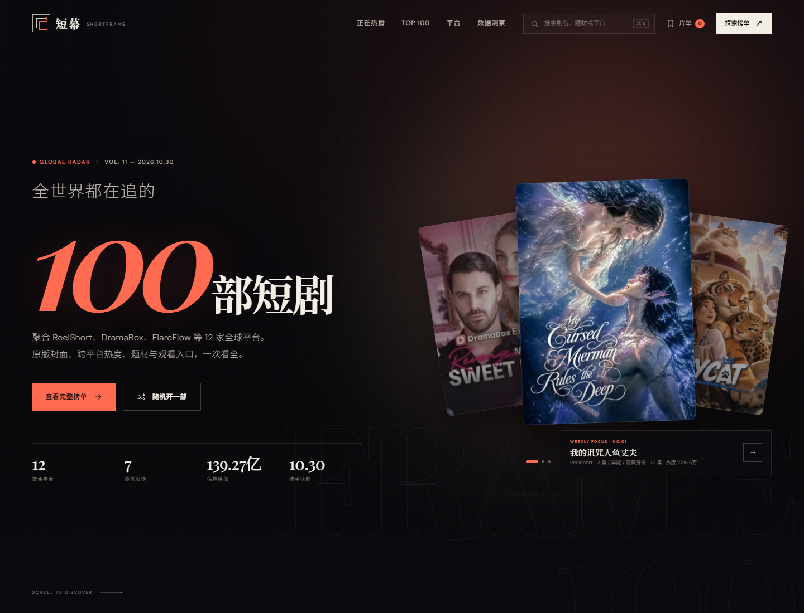
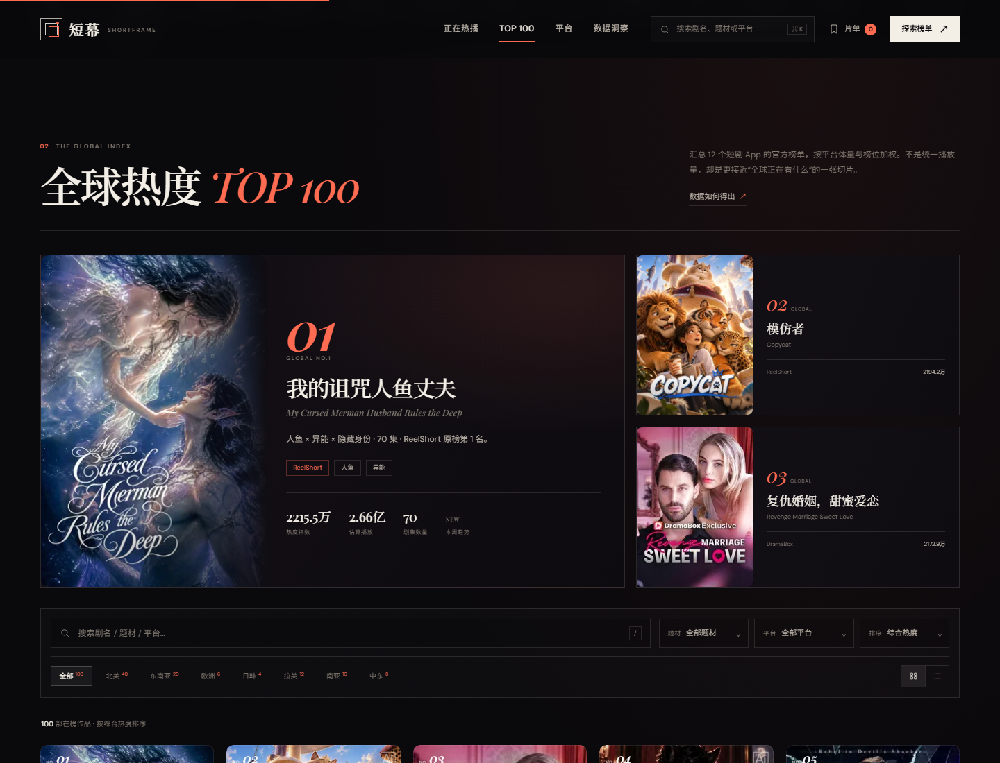
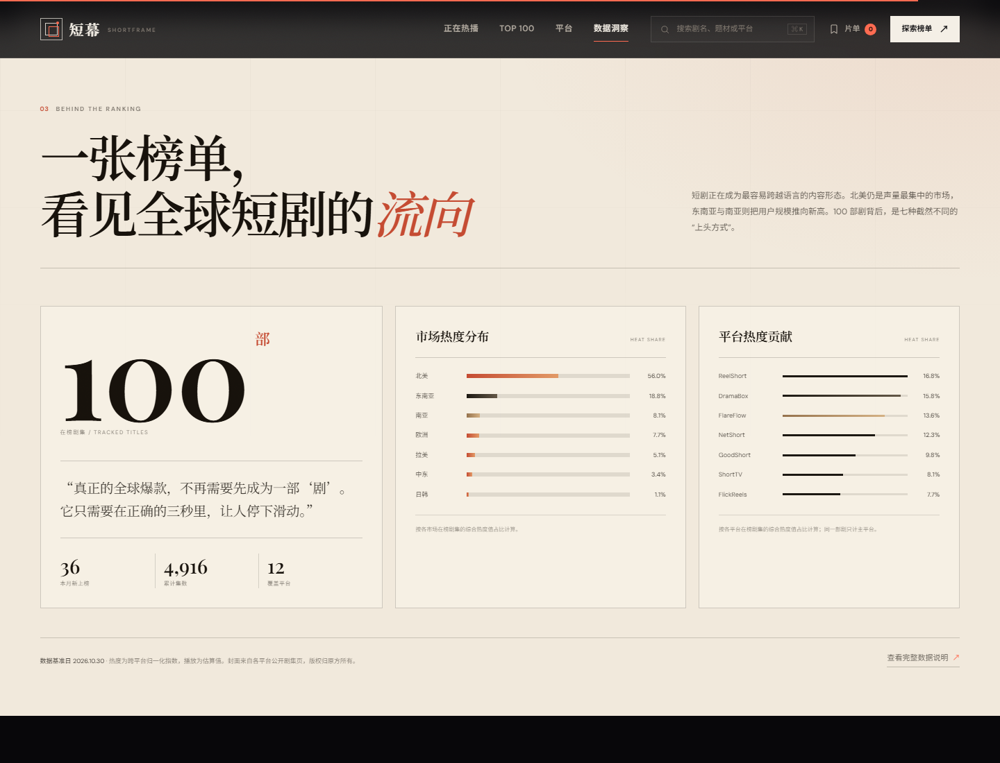
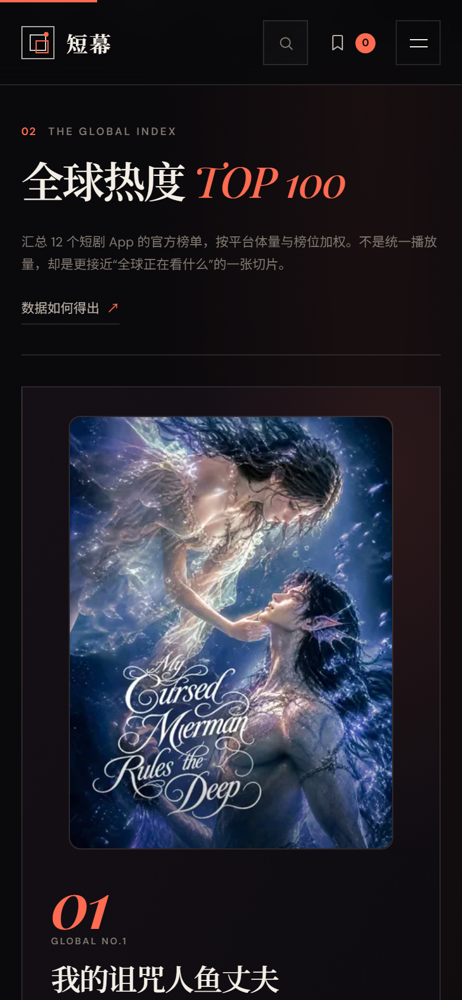

# 短幕 SHORTFRAME · 全球热播短剧 TOP 100

一个参考 ReelShort 的内容消费逻辑、但重新设计的全球短剧聚合站。把分散在 ReelShort、DramaBox、FlareFlow、NetShort、FlickReels 等 12 个短剧 App 的 100 部当前在榜短剧，放进同一套「全球热度榜」里：可以按市场、题材、平台筛选，看趋势、查热度、收藏片单，再跳转官方平台观看。

> 这是一个**产品原型 / 前端演示站**，不是官方榜单，也不提供剧集资源。每一张封面都来自对应短剧在各平台公开剧集页的原版物料；热度是跨平台归一化指数，播放量为估算值，详细口径见站内「数据说明」。









---

## 快速打开

### 方式一：直接双击

直接打开 `index.html` 即可。这是一个零依赖静态站，所有数据在 `data.js`，100 张原版封面已下载到 `assets/covers/`，不需要构建、不需要 API Key。图片加载失败时会自动回退到 CSS 生成封面。

### 方式二：本地静态服务器（推荐）

```bash
cd shortframe
python -m http.server 8000
```

打开 <http://127.0.0.1:8000>。

Windows 也可以双击 `serve.cmd`。

---

## 设计思路

参考站 ReelShort 的核心体验是「滑动、封面、立刻开始看」。短幕保留这种内容消费的直觉，但把「聚合」和「发现」做得更明确：

- **不是又一个单平台片库**。首屏直接给出全球榜单的规模感，平台只作为来源标签。
- **杂志式编辑感**，而不是电商货架。衬线标题、编号系统、奶油纸色数据区、超大榜单词，让「排名」本身成为内容。
- **原版封面优先**。100 部剧全部使用对应平台公开剧集页的原版海报，让每部剧的脸、色调与类型一眼可辨；封面统一 10px 圆角，卡片、首屏、榜单与详情页保持同一套弧度。同时保留 14 套 CSS 主题作为加载失败时的回退。
- **信息有层级**。首屏精选 → 正在热播 → TOP 100 → 市场洞察。用户可以从「随便逛逛」自然走到「认真挑一部」。
- **可操作性**。筛选、排序、搜索、收藏、详情、相似推荐、跳转官方平台，全部真实可用。

### 视觉系统

| 项目 | 选择 |
| --- | --- |
| 底色 | `#09080b` 近黑，带一点暖紫 |
| 强调色 | `#ff6b51` 珊瑚橙红，对应短剧的高浓度情绪 |
| 辅助色 | 香槟金 `#e8c28b`、纸色 `#f1e9dc` |
| 中文标题 | Noto Serif SC / 宋体回退 |
| 英文展示 | Playfair Display / Didot 回退 |
| 正文 | DM Sans / PingFang SC / 微软雅黑 |
| 版式 | 编辑式栅格 + 编号系统，圆角克制，主要靠线与留白 |

---

## 页面结构

1. **Hero / 全球指数**
   - 超大 `100` 数字、平台/市场/估算播放统计
   - 三张叠放的原版封面，自动轮播，可点击切换或打开详情

2. **Radar Ticker**
   - TOP 12 跨平台热度滚动条，悬停暂停

3. **正在热播**
   - 横向滑动卡片，支持左右按钮，移动端手势滑动

4. **平台带**
   - 12 家平台及在榜数量，点击直达官方入口

5. **全球热度 TOP 100**
   - TOP 3 编辑推荐位：榜首大卡 + 第二、第三小卡
   - 市场 chips、题材筛选、平台筛选、排序、关键词搜索
   - 网格 / 列表双视图
   - 每次加载 24 部，带进度条
   - 收藏按钮、热度趋势、18+ / 平台冠军 / 爆款 / 新剧等标签

6. **数据洞察（纸色区）**
   - 100 部在榜、本月新上榜数、累计集数、12 平台
   - 市场热度占比条形图
   - 平台在榜数量条形图
   - 数据边界说明

7. **详情弹层**
   - 大尺寸原版封面、排名、中文名、英文原名、题材、官方英文简介
   - 官方平台深链、加入片单、相似推荐、资料与封面来源

8. **搜索 / 片单 / 数据说明**
   - 全屏搜索（`⌘K` / `Ctrl K` / `/`），实时结果，方向键 + Enter
   - 右侧片单抽屉，`localStorage` 本地保存
   - 数据方法弹层，附公开参考来源

---

## 交互清单

- [x] Hero 精选自动轮播（7.6s），悬停暂停
- [x] 点击侧边海报切换，点击中间海报打开详情
- [x] TOP 100 市场 / 题材 / 平台筛选
- [x] 综合热度 / 上升最快 / 最新上线 / 集数最多排序
- [x] 关键词搜索，支持剧名、英文名、平台、题材
- [x] 网格 / 列表视图切换
- [x] 分页加载（每次 24 部）+ 进度
- [x] 片单收藏，刷新后保留
- [x] 详情弹层 + 相似推荐
- [x] 官方平台跳转
- [x] 全屏搜索，键盘导航
- [x] 响应式：桌面 / 平板 / 手机
- [x] 键盘可访问：Tab 焦点、Esc 关闭、方向键搜索、卡片 Enter/Space
- [x] `prefers-reduced-motion` 降低动画

---

## 数据说明

### 样本

- **100 部真实在榜剧集**，来自 12 个短剧 App：ReelShort、DramaBox、FlareFlow、NetShort、FlickReels、GoodShort、ShortTV、WeTV、MoboReels、FlexTV、Vigloo、Vert TV。
- 每个平台抓取当前榜单前 10 名，去重后按「平台权重 80% + 榜位 20%」排序，保留前 100 部。每个平台至少保留 3 部，避免小平台被完全挤出。
- 覆盖 7 个市场：北美 40、东南亚 20、拉美 12、南亚 10、中东 8、欧洲 6、日韩 4。
- 数据快照：**2026-10-30**，来自 [MicroDrama Radar](https://www.microdramaradar.com/en/apps) 对各 App 官方榜单的记录。
- 封面：**100 张原版剧集封面**，已下载至 `assets/covers/`，来源为各平台公开剧集页。版权归原平台与制作方所有，仅用于内容识别与导航。逐张来源见 [COVERS.md](COVERS.md)。

### 热度指数

站内热度为跨平台归一化指数，不是官方播放量：

```text
平台权重 80%
+ 站内榜位 20%
→ 归一化 → 0–100 指数 → 换算为展示热度
```

- 平台权重按 App 当前用户规模与全球能见度分档，属于编辑估计。
- 同一部剧在多个平台出现时按最高分去重。
- 「估算播放」= 热度 × 固定系数，仅用于站内横向比较。

### 内容字段

| 字段 | 来源 |
| --- | --- |
| 英文名 / 中文名 | 官方剧名 + 站内翻译 |
| 平台 / 平台原榜名次 | App 官方榜单 |
| 集数 / 上线年份 | 剧集详情页 |
| 题材 | 官方题材标签，映射为中文 |
| 剧情 | 官方英文简介原文，保留出处 |
| 封面 | 平台公开剧集封面，本地缓存 |
| 官方入口 | App 内剧集深链 |

### 公开参考

- [MicroDrama Radar：12 个短剧 App 官方榜单索引](https://www.microdramaradar.com/en/apps)
- [DataEye：2026 年 4 月海外短剧百强榜（行业背景）](https://www.36dianping.com/p/dp3810346794836228)
- [DataEye：2026 年 10 月海外短剧市场观察](https://m.jiemian.com/article/13626587.html)

### 必须说明的边界

1. 海外短剧没有统一的全球播放量口径，任何「TOP 100 播放榜」都需要说明数据来源。
2. 本榜单是 12 个 App 当前榜单的**跨平台聚合**，不是官方全球总榜，也不代表统一播放量。
3. 剧名、平台名、封面与简介归各自权利人所有。本站不存储、不转播、不提供任何剧集资源；观看按钮跳转至官方平台深链。
4. 封面为平台公开物料，仅用于内容识别与导航；如权利人要求下线，可删除对应 `assets/covers/` 文件并替换为回退图。

---

## 文件结构

```text
shortframe/
├── index.html              # 页面结构、图标 sprite、弹层
├── styles.css              # 设计系统、封面布局、回退艺术、响应式
├── data.js                 # 100 部剧数据 + 12 个平台入口
├── app.js                  # 渲染、筛选、搜索、片单、弹层、键盘交互
├── COVERS.md               # 100 张封面的逐张来源清单
├── serve.cmd               # Windows 本地服务器
├── preview-desktop.png     # 桌面首屏
├── preview-ranking.png     # TOP 100 榜单
├── preview-detail.png      # 详情弹层
├── preview-insights.png    # 数据洞察
├── preview-mobile.png      # 移动端榜单
├── assets/
│   ├── covers/             # 100 张原版剧集封面（webp）
│   ├── favicon.svg
│   └── og-cover.png        # 1200×630 分享图
└── README.md
```

---

## 二次开发

### 换一部剧

编辑 `data.js` 的 `window.DRAMAS` 数组，每个对象的主要字段：

```js
{
  id: "d001",
  rank: 1,
  title: "My Cursed Merman Husband Rules the Deep", // 英文原名
  cn: "我的诅咒人鱼丈夫",                          // 中文名
  platform: "ReelShort",                          // 平台
  appRank: 1,                                     // 平台原榜名次
  region: "北美",
  language: "英语",
  genres: ["人鱼", "异能", "隐藏身份"],
  episodes: 70,
  year: 2026,
  heat: 22155000,          // 站内热度指数
  views: 265860000,        // 估算播放
  trend: "new",            // 数字 / "new" / 0
  badge: "平台冠军",
  cover: "assets/covers/my-cursed-merman-husband-rules-the-deep.webp",
  synopsis: "官方英文剧情简介…",
  desc: "人鱼 × 异能 × 隐藏身份 · 70 集 · ReelShort 原榜第 1 名。",
  sourceUrl: "https://www.microdramaradar.com/en/series/…",
  platformUrl: "https://www.reelshort.com/movie/…"
}
```

新增封面时，把图片放进 `assets/covers/`，并把 `cover` 指向它。没有 `cover` 或图片加载失败时，会自动使用 `theme + palette` 的 CSS 回退封面。

### 换回退封面主题

可用主题：`noir`、`gilded`、`lunar`、`skyline`、`silk`、`blade`、`grid`、`veil`、`bloom`、`ember`、`frost`、`desert`、`neon`、`forest`。

`palette` 是 `[主色, 深色, 辅色]` 三元组；只在原版封面缺失时可见。

### 改品牌色

编辑 `styles.css` 顶部的 `:root`：

```css
--accent: #ff6b51;
--paper: #f1e9dc;
--bg: #09080b;
```

### 接真实数据

`data.js` 现在是静态快照。要接真实 API，可保留 `window.DRAMAS` 的结构，在 `app.js` 的 `init()` 之前异步拉取并映射字段。注意：

- 平台官方海报通常有版权限制，生产环境需要授权；
- 播放量、热度需要标明口径；
- 外链要加 `rel="noopener"`。

---

## 已知限制

- 这是静态原型，没有账号体系、后端、支付或真实播放器。
- 热度与播放为演示用估算，不保证与平台后台一致。
- 部分平台官方站点域名可能随地区/时间变化，也可能限制地区访问；`data.js` 中的 `PLATFORM_URLS` 可统一替换。FlickReels 的官网入口使用其当前官方域名 `flickreels.net`。
- 官方剧情简介保留英文原文，避免机器翻译造成剧情误读；剧名、题材与界面文案为中文。
- 字体来自 Google Fonts，离线时会回退到系统字体，版式仍然成立。

---

## License / 使用

代码可自由用于学习与二次开发。剧名、平台名称、商标归各自权利人所有；请勿把演示榜单直接包装为官方数据发布。
